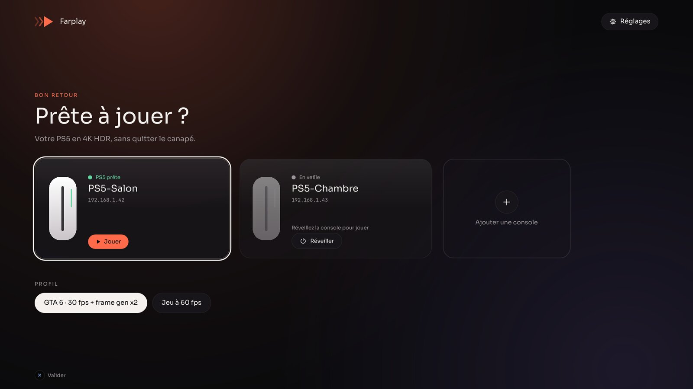
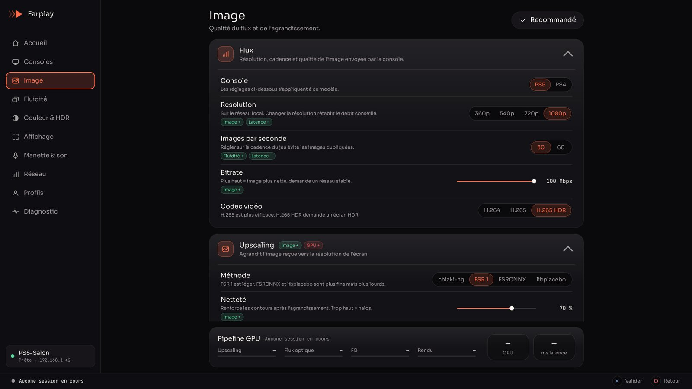
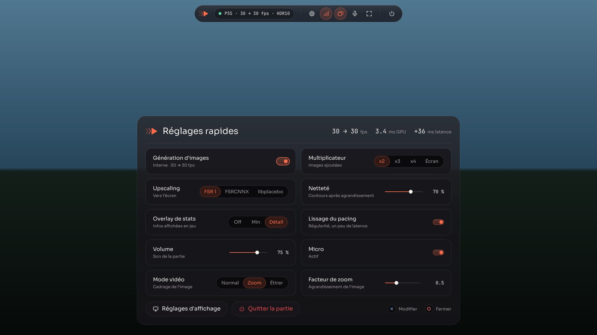

  

<h1 align="center">Farplay</h1>

  Client PS5 Remote Play pour Windows 11 : un flux 1080p / 30 fps affiché en 4K / 60 fps et plus, 
  en HDR, avec le moins de latence ajoutée possible.

## Ce que fait Farplay

- **Image** : réduction des artefacts de compression, couleurs reconstruites à pleine résolution, agrandissement FSR 1 (ou FSRCNNX), lissage des dégradés. Environ 1 ms GPU en tout.
- **Fluidité** : génération d'images interne (flux optique + interpolation, protection du HUD), x2 à x4 ou fréquence de l'écran ; lissage du pacing avec le son recalé sur l'image ; AFMF du pilote AMD en option.
- **HDR** : HDR10 de bout en bout, diagnostic de la chaîne PS5 → écran.
- **Interface** : pensée pour la manette, réglages rapides en jeu, barre du haut à la souris, profils par jeu, overlay de stats (F3) et journal CSV.

| Réglages | Réglages rapides en jeu |
| --- | --- |
|  |  |

## Installation

Les builds de test sont produits par GitHub Actions (onglet *Actions* → *Farplay Windows x64*). Décompresser l'archive dans un dossier et lancer `farplay.exe` ; `vc_redist.x64.exe` est fourni si les bibliothèques Visual C++ manquent.

Raccourcis en jeu : **F3** overlay de stats, **F4** coupe/rétablit la génération d'images, bouton **PS** (ou Ctrl+O) réglages rapides.

## Documentation

- [Cahier des charges](docs/cahier-des-charges.md)
- [Journal d'avancement](docs/PROGRESS.md)
- [Feuille de route](docs/feuille-de-route.md)

## Crédits et licence

Farplay est un fork de [chiaki-ng](https://github.com/streetpea/chiaki-ng) (lui-même successeur de Chiaki) et reste sous licence **AGPL-3.0** ; voir [`LICENSES/`](LICENSES) et [`NOTICE`](NOTICE). Il utilise notamment libplacebo, FFmpeg, Qt, AMD FidelityFX FSR 1 (MIT), et les polices Sora et JetBrains Mono (OFL).

Ce projet n'est ni approuvé ni certifié par Sony Interactive Entertainment LLC.
